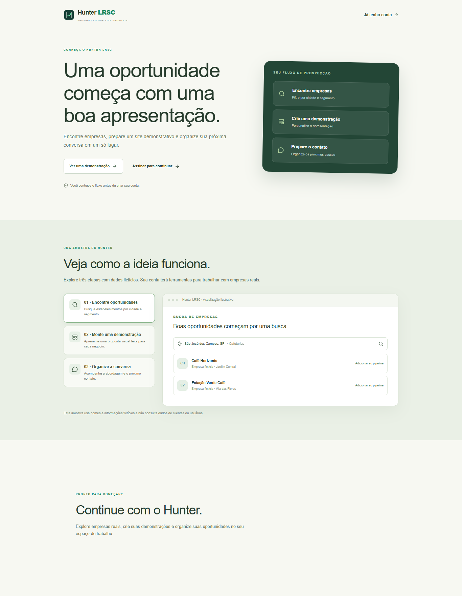
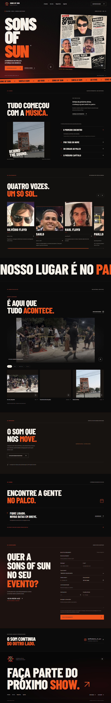
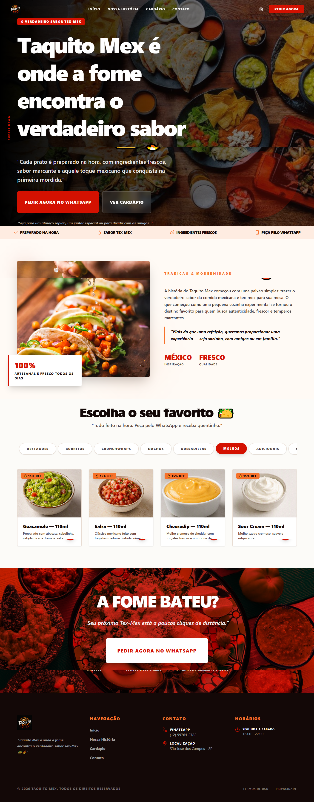

# Olá, eu sou Lucas Robson! 👋

### 💻 Desenvolvedor Web em formação | Criador de Soluções Digitais

Bem-vindo ao meu espaço no GitHub!

Sou entusiasta de tecnologia, desenvolvimento web e
criação de soluções digitais.

Atualmente estudo programação e desenvolvo projetos
com o auxílio de inteligência artificial, transformando
ideias em aplicações e experiências digitais.

Meu objetivo é evoluir tecnicamente, construir
produtos digitais e conquistar oportunidades
profissionais na área de desenvolvimento web.

---

## 🚀 Minhas Criações

Aqui compartilho projetos que idealizei e desenvolvi
utilizando ferramentas digitais e inteligência artificial.

### 🔎 Hunter LRSC

Plataforma SaaS voltada à prospecção comercial,
pesquisa de estabelecimentos e organização
de oportunidades de negócio.

**Categoria:** SaaS | Automação | Gestão Comercial

🌐 [Conhecer o Hunter LRSC](https://hunterlrsc.shop/)

---

### 🎸 Sons of Sun

Website de uma banda de rock, com identidade
visual personalizada, apresentação dos integrantes,
galeria e recursos para contratação de shows.

**Categoria:** Website | Música | Experiência Digital

---

### 🌮 Taquito Mex

Projeto digital voltado à apresentação de produtos
gastronômicos, cardápio e experiência do cliente.

**Categoria:** Gastronomia | Cardápio Digital

---

### 🌶️ Dona Santos Cocina Mexicana

Projeto de presença digital para uma marca
do segmento gastronômico.

**Categoria:** Website | Negócios

---

### 🌐 LucasFreeBuff

Projeto web integrante do meu portfólio
de criações digitais.

**Categoria:** Desenvolvimento Web

---

## 📚 Minha Jornada na Programação

Estou construindo meus conhecimentos em:

- HTML e CSS
- JavaScript
- Git e GitHub
- Desenvolvimento Web
- Integração de ferramentas e APIs

Utilizo inteligência artificial como ferramenta
de apoio no desenvolvimento dos meus projetos,
enquanto aprofundo minhas habilidades técnicas.

## 🌍 Meu Portfólio

Conheça mais sobre meus projetos e soluções digitais:

🔗 [Acessar meu portfólio](https://portfolio.hunterlrsc.shop/)

---

⭐ Construindo, aprendendo e evoluindo a cada projeto.
